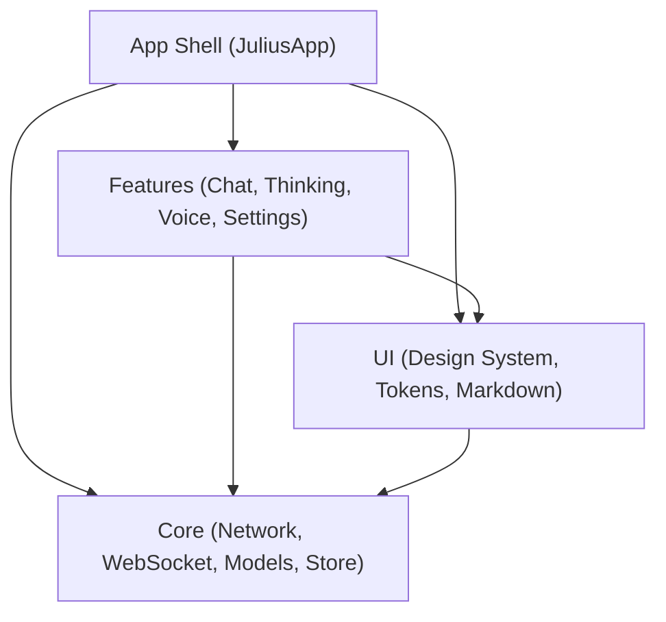
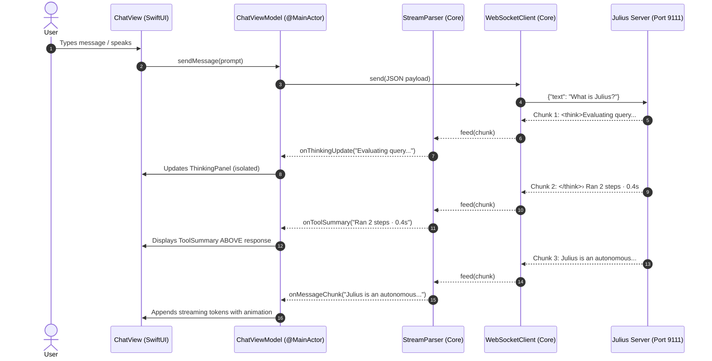

# Julius iOS — Architecture Blueprint

This document defines the structural architecture, module separation, data flow, and design patterns for the **Julius iOS** application, conforming to the **Tuist modular standard** established by the `app-creator` skill.

---

## 1. Architectural Principles

1. **Thin App Shell**: The root `App` target contains no business logic. It handles only dependency injection, window group setup, and root navigation.
2. **Strict Module Separation**:
   - `Core` has no UI imports (pure Swift, protocols, network, storage).
   - `UI` contains reusable design system components and tokens (no feature logic).
   - `Features` contains view models, screens, and workflows, depending on `Core` and `UI`.
3. **Protocol-Based Dependency Injection**: All networking, storage, audio, and device services are exposed via Swift protocols, enabling 100% mocked offline testing.
4. **Swift 6 Strict Concurrency**: All models crossing boundaries are `Sendable`; view models are isolated to `@MainActor`.
5. **Modern Observation**: Uses Apple's modern `@Observable` macro (Swift 5.9+ / iOS 17+) for fine-grained view redraw minimization.

---

## 2. Target Dependency Graph



---

## 3. Directory Layout Specification

When the user triggers the application generation phase, the project will be structured as follows:

```
Julius_iOS/
├── Project.swift               # Tuist declarative workspace definition
├── Tuist.swift                 # Tuist project configuration
├── README.md                   # Setup guide and usage instructions
├── PREREQUISITES.md            # Environment & machine requirements
├── REQUIREMENTS.md             # Functional & technical requirements
├── ARCHITECTURE.md             # This architecture blueprint
├── Brewfile                    # Homebrew dependencies
├── check_prerequisites.sh      # Automated prerequisite validation script
├── skills/                     # Local AI agent skills
│   ├── app-creator/            # iOS app creation engine & CI generator
│   ├── julius-design-system/   # Julius tokens, colors, fonts, cursor rules
│   ├── swiftui-architecture/   # Axiom SwiftUI architecture & best practices
│   ├── swift-concurrency/      # Swift 6 concurrency rules & patterns
│   └── swift-testing/          # Testing & snapshot methodologies
├── Sources/                    # (Generated upon app creation command)
│   ├── App/                    # Thin App Shell
│   │   ├── JuliusApp.swift     # @main entry point
│   │   ├── AppDependencies.swift # DI Container
│   │   └── RootCoordinator.swift # Navigation Router
│   ├── Core/                   # Logic, Networking & Data
│   │   ├── Models/             # Message, Session, ToolStep, ThoughtChunk
│   │   ├── Network/            # WebSocketClient, RESTClient, Endpoints
│   │   ├── Parser/             # StreamParser, ThinkingTagExtractor
│   │   ├── Storage/            # SwiftData SessionRepository, Keychain
│   │   └── Audio/              # SpeechRecognizer, AudioPlayer
│   ├── UI/                     # Design System & Primitives
│   │   ├── Tokens/             # Colors, Typography, Spacing, Shadows
│   │   ├── Components/         # ToolSummaryCard, ThinkingPanel, Bubble
│   │   ├── Markdown/           # MarkdownViewer, CodeHighlightView
│   │   └── Modifiers/          # CursorModifier, CardSurfaceModifier
│   └── Features/               # Feature Modules
│       ├── Chat/               # ChatView, ChatViewModel, InputBar
│       ├── Thinking/           # ThinkingTraceView, ThoughtAccordion
│       ├── Voice/              # VoiceModeView, WaveformVisualizer
│       ├── Sessions/           # SessionListView, SessionDrawer
│       └── Settings/           # SettingsView, ServerConfigView
├── Resources/                  # Assets, Fonts, Spec
│   ├── Fonts/                  # Julius-Regular.ttf, Julius-Bold.ttf
│   └── Assets.xcassets         # AppIcon, AccentColor, BrandMarks
└── Tests/                      # Comprehensive Test Suites
    ├── CoreTests/              # Unit tests for network, parser, storage
    ├── FeaturesTests/          # ViewModel state tests
    ├── UITests/                # Integration UI flows
    └── SnapshotTests/          # Visual snapshot regressions
```

---

## 4. End-to-End Data & Streaming Flow



---

## 5. State Management & Offline Resilience

1. **Active Stream State**: Kept in memory inside `ChatViewModel` as an immutable stream buffer to prevent repeated array re-allocations.
2. **Completed Messages**: Persisted asynchronously to local disk via `SwiftData` (`ModelContainer`).
3. **Pending Outbox**: If connection drops while sending, the message is queued in an offline `OutboxQueue` and auto-retried when `WebSocketClient` reconnects.

